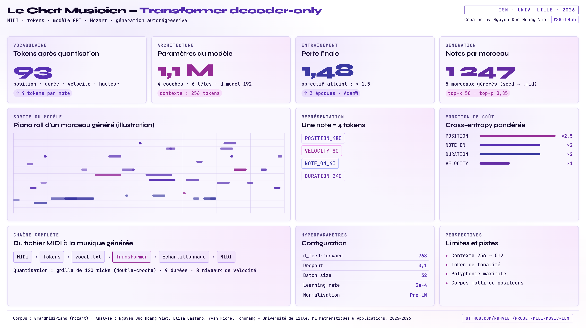

<div align="center">

<h1>MusicGPT</h1>

<p><em>Modèle de langage pour la génération automatique de musique MIDI</em></p>

<a href="#"></a>
<a href="#"></a>
<a href="#"></a>
<a href="#"></a>
<a href="#"></a>
<a href="#"></a>

</div>

<br>


<h2 align="center">Réalisé par</h2>

<div align="center">

| Membre | Contact |
|---|---|
| **Duc Hoang Viet NGUYEN** | [ndhviet.github.io](https://ndhviet.github.io/) |
| **Elisa CASTANO** | elisa.castano.etu@univ-lille.fr |
| **Yvan Michel TCHONANG** | [michel-tchonang.lovable.app](https://michel-tchonang.lovable.app/) |

</div>

# MusicGPT — Génération automatique de musique MIDI

## 1. Présentation du projet

MusicGPT est un modèle de langage entraîné sur des fichiers MIDI afin d'apprendre les régularités musicales et de générer de nouvelles séquences à partir d'une séquence de notes en entrée.

Projet réalisé dans le cadre du Master 1 Ingénierie Numérique et Statistique – Data Science (2025-2026). L'objectif est d'explorer l'utilisation des modèles de langage pour la prédiction de séquences musicales et la génération automatique de musique au format MIDI.

📄 [Ouvrir le rapport PDF](rapport.pdf)

---

## 2. Prérequis

Python 3.11+ recommandé. Créer et activer un environnement virtuel, puis installer les dépendances :

```bash
python3 -m venv llm-venv

# macOS / Linux
source llm-venv/bin/activate

# Windows
llm-venv\Scripts\activate

pip install -r requirements.txt
```

---

## 3. Structure des fichiers

| Fichier | Rôle |
|---|---|
| `filter.py` | Filtrage des fichiers MIDI par compositeur |
| `h0.py` | Tokenisation des fichiers MIDI |
| `h1.py` | Architecture du modèle MusicGPT |
| `h2.py` | Entraînement du modèle |
| `h3.py` | Génération de nouveaux morceaux MIDI |

---

## 4. Étapes pour reproduire le projet

**1. Préparer les données.** Placer le dossier `GrandMidiPiano/` (fichiers MIDI) à la racine du projet, au même niveau que les fichiers `.py`, puis lancer le filtrage :
```bash
python filter.py
```
Cela crée `mozart_dataset/` et `beethoven_dataset/`. La suite du projet utilise `mozart_dataset/`.

**2. Tokeniser les données.**
```bash
python h0.py
```
Génère `vocab.txt` et `dataset.txt`.

**3. Entraîner le modèle.**
```bash
python h2.py
```
Le meilleur modèle est sauvegardé dans `checkpoints/best_model.pt`.

**4. Générer de la musique.**
```bash
python h3.py
```
Les fichiers MIDI générés apparaissent dans `generated_music/`.

---

## 5. Ressources

- **Écouter les fichiers MIDI :** [signal.vercel.app](https://signal.vercel.app) ou [miditoolbox.com/player](https://miditoolbox.com/player) (en ligne, gratuit).
- **Exemples audio :** le dossier `sample/` contient des morceaux générés par le modèle, au format MP3.
- **Entraînement :** il peut prendre plusieurs dizaines de minutes. Le dossier `checkpoints/` contient déjà un modèle entraîné, on peut donc passer directement à l'étape 4.
- **Autre version :** développée par **Yvan Michel TCHONANG**, où les fichiers MIDI sont d'abord convertis en CSV avant l'entraînement. Le code est dans `michel/` ([télécharger cette version](https://drive.google.com/file/d/1zCtGJt5VyUaAaJJaxiEbPpnf1ostr_za/view?usp=sharing)).

---

## 6. Dashboard

[](https://ndhviet.github.io/Projet-Midi-Music-LLM/)

➡️ Cliquez sur l'image pour ouvrir le dashboard.
